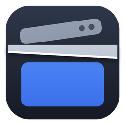

# Guillotine

Borderless, exact-resolution window placement for ultrawide streaming.

Guillotine moves a game window to a zone on your monitor, resizes it to an exact resolution, and removes the title bar and borders so the client area is the full size. The main use is streaming at true 1440p from a super-ultrawide monitor, where window borders would otherwise take pixels off the captured frame.

> **Status:** 0.2.0. Placement, borderless and always-on-top work from the tray app and the command line. Auto-apply on launch and custom presets are not built yet (see [docs/ROADMAP.md](docs/ROADMAP.md)).

## Download

Each build makes `Guillotine.exe` (the app) and `guillotine-cli.exe` (the command line) for 64-bit Windows 10 or 11, in two flavours:

| Flavour | Size | Needs |
|---|---|---|
| **all-in-one** | ~65 MB app, ~34 MB CLI | Nothing; .NET is bundled inside |
| **lean** | ~7 MB app, ~0.3 MB CLI | The [.NET 8 Desktop Runtime](https://dotnet.microsoft.com/download/dotnet/8.0) (x64). If it is missing, Windows offers a download link when you start the app. |

Get them from [Releases](../../releases), or from the `guillotine-win-x64-all-in-one` and `guillotine-win-x64-lean` artifacts on the latest [Build run](../../actions/workflows/build.yml).

Keep `settings.json` next to the exe to set your defaults and games. If that folder is not writable (for example under Program Files), the app saves its settings to `%APPDATA%\Guillotine\settings.json` instead.

## Using the app

Guillotine lives in the notification area (system tray). **Left-click its icon**, or press **Ctrl+Alt+G**, to open a small panel above the tray; it stays above every other window, including always-on-top games, and hides again when you click elsewhere or press Esc. Right-click the icon for Open and Exit.

1. Start the game in windowed mode, then open the panel.
2. Pick the game from the window list. A game listed in `settings.json` is picked automatically, along with its size and zone.
3. **Borderless** and **Always on top** act immediately on the selected window. Turning borderless on or off keeps the game picture exactly where it is; only the title bar and borders come and go.
4. Choose the client size and zone, then click **Apply**. The status bar confirms that the client area is exactly the size you asked for, or says what the game chose instead.
5. **Restore** puts the title bar and borders back and turns off always on top.

At the bottom of the panel:

- **Hotkey**: click it and press a new combination (it needs Ctrl, Alt or Win). Esc cancels; Backspace turns the hotkey off. It is saved to `settings.json`.
- **Start with Windows**: starts Guillotine hidden in the tray when you sign in. If Guillotine is running as administrator when you turn this on, it registers a scheduled task that starts it as administrator, so it can still control games that run as administrator.

Launching Guillotine again while it is running just opens the panel. If the game runs as administrator, run Guillotine as administrator too, or Windows will block the changes.

## How zones work

Zones are never stored as pixel coordinates. Each time, they are computed from the monitor's current bounds and the size you want:

- left X = `monitor.Left`, center X = `monitor.Left + (monitor.Width - width) / 2`, right X = `monitor.Right - width`
- top Y = `monitor.Top`, center Y = `monitor.Top + (monitor.Height - height) / 2`, bottom Y = `monitor.Bottom - height`

On a 5120x1440 monitor with a 2560x1440 window, that gives left at X = 0, center at X = 1280 and right at X = 2560. Zone names are `left`, `center`, `right`, `top`, `bottom`, or a pair with the vertical part first, such as `top-left` or `bottom-right`.

## Command line

```
guillotine-cli monitors                                   # bounds, work area and DPI scaling per monitor
guillotine-cli zones --size 1920x1080                     # derived zone positions per monitor
guillotine-cli windows                                    # open windows with process, client size and flags
guillotine-cli apply                                      # place the first running game from settings.json
guillotine-cli apply --title "Heroes of the Storm" --zone right --wait
guillotine-cli apply --process HeroesOfTheStorm_x64 --size 2560x1440 --framed
guillotine-cli borderless on|off --title "Heroes of the Storm"
guillotine-cli topmost on|off --title "Heroes of the Storm"
guillotine-cli restore --title "Heroes of the Storm"
guillotine-cli apply --title "Heroes of the Storm" --hold 30   # put it back if the game moves or resizes it
guillotine-cli startup on|off|status                           # start the app in the tray when you sign in
```

- Target a window with `--title` (part of the title), `--process` (process name) or `--handle` (from `windows`). With no target, the first running game from `settings.json` is used. `--wait` keeps checking until the window appears.
- `apply` takes `--size`, `--zone`, `--borderless`/`--framed`, `--topmost`/`--no-topmost` and `--work-area` to override the settings. It checks the client area afterwards and exits with code 2 if it does not match.
- `--hold SECONDS` keeps watching after `apply` and puts the window back whenever the game changes it, logging each correction. It stops after 10 corrections so it never fights a game forever.
- Title matching prefers an exact title over one that merely contains the text, and never picks the terminal you ran the command from.
- `zones --monitor 5120x1440` (optionally `5120x1440@X,Y`) uses the bounds you give instead of reading real monitors, so you can check the math on any OS.
- `monitors` is the quickest way to confirm your monitor is one 5120x1440 display at 100% scaling.

### How placement works

- **Borderless** removes the title bar, resize frame and edge styles and makes the window a popup, so the whole window is client area. The original style is saved on the window itself, so `restore` (from the app or the command line) puts it back exactly.
- **Framed** keeps the frame and sizes the window so the *client area* is still the exact size and sits on the zone; the frame extends outside it.
- The window is placed on the monitor it is currently on. Move it to another monitor first to use that one.
- If the window refuses the size, Guillotine retries while bypassing the window's own size limits.
- If the game still resizes itself to a size of its own choosing, Guillotine places that size in the requested zone instead and tells you what the game chose.

### Known game behaviour

- **Heroes of the Storm** limits its own window and resizes itself back immediately, so no external tool can override it:
  - *Windowed*: 16:9, at most the monitor height minus its own title bar and borders (37 px), even when the border has been removed. On a 1440-tall monitor that is **2494x1403**. Sizes that fit, such as 1920x1080, work exactly.
  - *Windowed (Fullscreen)*: full monitor height, but no wider than 21:9 (3440x1440 on a 1440-tall monitor).
  - For a 1440p stream from a 1440-tall monitor, run windowed and let OBS scale 2494x1403 up to 2560x1440, or play at 1920x1080 for an exact 1080p stream.
- **Display scaling** other than 100% can make Windows stretch games that are not DPI aware, which softens the picture. `guillotine-cli monitors` shows the current scaling.

## Settings

`settings.json` holds only preferences. It never holds zone coordinates.

```json
{
  "desiredWidth": 2560,
  "desiredHeight": 1440,
  "defaultZone": "center",
  "borderless": true,
  "topmost": false,
  "useWorkArea": false,
  "games": [
    { "match": "Heroes of the Storm", "by": "title" }
  ]
}
```

Each entry in `games` matches by `title` (part of the window title) or `process` (process name without `.exe`) and can override `desiredWidth`, `desiredHeight`, `zone`, `borderless` and `topmost`.

## Project layout

| Path | Contents |
|---|---|
| `src/Guillotine.Core` | Zone math, sizes and settings. Platform independent. |
| `src/Guillotine.Windows` | Win32 interop: monitors, window enumeration and placement. |
| `src/Guillotine.App` | The app (`Guillotine.exe`), WPF with [WPF-UI](https://github.com/lepoco/wpfui). |
| `src/Guillotine.Cli` | The command line (`guillotine-cli.exe`). |
| `tests/Guillotine.Core.Tests` | xUnit tests for the core library. |

## Building

Requires the [.NET 8 SDK](https://dotnet.microsoft.com/download/dotnet/8.0). `dotnet build` and `dotnet test` work on any OS; the app and window commands only run on Windows.

To make the single-file exes yourself (use `src/Guillotine.Cli` for the CLI):

```
# all-in-one
dotnet publish src/Guillotine.App -c Release -r win-x64 -p:PublishSingleFile=true --self-contained true -p:IncludeNativeLibrariesForSelfExtract=true -p:EnableCompressionInSingleFile=true -o publish/all-in-one
# lean
dotnet publish src/Guillotine.App -c Release -r win-x64 -p:PublishSingleFile=true --self-contained false -o publish/lean
```

To publish a release, run the **Build** workflow from the Actions tab with a version such as `0.1.0` (or push a tag such as `v0.1.0`). It creates the tag and a GitHub release with one zip per flavour. Update `<Version>` in `Directory.Build.props` first so the exes report the same version.

The icon is drawn by `assets/make_icon.py` (needs Pillow). Run `python3 assets/make_icon.py` to regenerate `assets/guillotine.ico` after changing it.

## License

[MIT](LICENSE)
